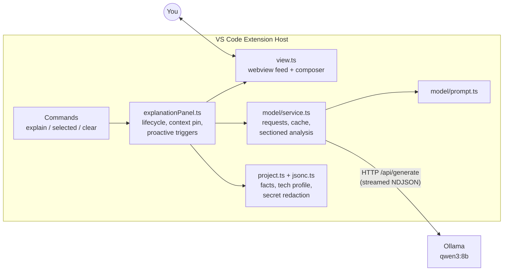

# Tancode

**Build with AI. Understand what you built.**

Tancode is a local-first AI coding mentor for VS Code. It helps developers who build quickly with AI tools ("vibe coding") actually understand the code, errors, configuration, dependencies, and design decisions behind what they built — without sending source code to any external service.

All inference runs against a locally installed Ollama server. Nothing is uploaded.

## Features

- **Chat-first coding mentor** — a conversational panel where Tancode can also speak first: user questions, plans, code tasks, debugging requests, explanations, and follow-ups are sent as actual chat turns; current file/selection context is supporting evidence, not a forced explanation request.
- **File explanations** — open a supported source file and get a concise, educational explanation of what it does.
- **Selected-code context** — select code and run *Tancode: Explain Selected Code* for an explanation, a structured Learn breakdown, or a "Test My Understanding" quiz.
- **Proactive learning insights** — event-driven notes on meaningful saves, new diagnostics, and opened project manifests; debounced, deduplicated, cooldown-gated, and pausable.
- **Error and diagnostic explanations** — explains what the editor diagnostic actually says, the likely cause, the underlying concept, and how to verify a fix — never applies changes.
- **JSON/JSONC support** — `.json` and `.jsonc` files (including `tsconfig.json` with comments and trailing commas) get structural explanations; invalid or incomplete JSON is reported as such, never treated as valid.
- **Project version awareness** — a local tech profile distinguishes **declared** manifest ranges, **resolved** lockfile versions, and **detected runtime** versions. Opening a manifest posts one grounded note.
- **Technical + simplified explanations** — substantial answers teach WHAT → HOW → WHY, plus a plain-language version and a real-world analogy when enabled.
- **Large-file analysis** — files larger than the configured prompt budget are analyzed in sequential sections (declaration-aware splitting, rolling summaries, cross-section symbol carry-over) and combined with honest scope disclosure — never silently truncated or rejected.
- **Streaming + cancellation** — responses stream token-by-token; switching context or pressing Stop aborts in-flight requests. User chat uses Ollama `/api/chat` roles, while explanations and proactive mentoring remain separate `/api/generate` flows.
- **Privacy** — local Ollama only, no cloud AI, no telemetry, no automatic code edits, secret-looking config values redacted before prompts.
- **Broad project scanning** — one shared registry recognizes web files (including CSS/SCSS, HTML, JSX/TSX, Vue, Svelte, Astro), programming languages, JSON/YAML/TOML/XML/INI, Docker and build files, Terraform/HCL, Markdown/docs, CSV/TSV, Protocol Buffers, notebooks, lockfiles, and useful hidden dotfiles.

## Architecture



- **TypeScript VS Code extension** — VS Code coupling lives in `explanationPanel.ts`; model, prompt, cache, view, and message contracts are plain modules testable in Node.
- **Webview UI** — a conversation feed (you + tagged assistant notes) under a pinned context card, with a composer; all model output is HTML-escaped under a locked-down CSP.
- **Ollama HTTP client** — `POST {baseUrl}/api/generate`, NDJSON streaming, `think: false`, `keep_alive: "10m"`, per-mode `num_predict` caps, and `AbortSignal` cancellation. Default model: `qwen3:8b` (configurable).
- **Deterministic local analysis** — project facts and the tech profile are extracted locally (manifests, lockfiles, toolchain files); Qwen explains meaning, it never invents structure or versions.
- **Large files** — over the prompt budget → `splitSections` cuts on declaration/line boundaries → per-section summaries in sequence → one combine request with failure disclosure.
- **No repository-wide indexing** — only the active file, selection, diagnostics, and manifest facts are read.

## Prerequisites

- **Node.js ≥ 20** (see `engines` in `package.json`) and npm.
- **VS Code ≥ 1.90** (`engines.vscode`).
- **Ollama** installed and running locally — [https://ollama.com](https://ollama.com). Check whether you already have a compatible model:

  ```bash
  ollama list
  ```

  Any model name in that list works — point `tancode.ollama.model` at it. `qwen3:8b` is only the default, not a requirement.

## Installation

```bash
git clone https://github.com/fidhaaann/Tancode-.git
cd Tancode-
npm ci
npm run compile
```

Optional verification:

```bash
npm run typecheck
npm test
```

## Configure Ollama

```bash
ollama list                              # installed models
ollama serve                             # start the server if it isn't running
ollama run qwen3:8b                      # sanity-check the configured model
curl http://127.0.0.1:11434/api/tags     # verify the local API
```

Then set the model in VS Code: **Settings → search `tancode.ollama.model`** and enter a tag from `ollama list` (e.g. `qwen3:8b`, `qwen3:4b`, `codellama:7b`).

Common issues:

- **`unavailable`** — Ollama isn't running or `tancode.ollama.baseUrl` is wrong. Start it with `ollama serve` or the Ollama app.
- **`modelMissing`** — the configured tag isn't installed; pick one from `ollama list` or `ollama pull <name>`.
- **`timeout`** — the model needed more than `tancode.requestTimeoutMs` (default 120 s); raise it or use a smaller model.
- **Slow replies** — Tancode already sends `think: false`; a smaller/faster model helps further.
- Watch **Output → Tancode** for per-request status, model, duration, and cache lines — it names the real failure. Never expose the Ollama endpoint publicly: inference is local by design, and the endpoint has no auth.

## Run Tancode in development

1. Open this repository in VS Code.
2. `npm ci` then `npm run compile`.
3. Press **F5** to launch the Extension Development Host (its title bar shows `[Extension Development Host]`).
4. In the EDH window, open a source file or a supported config file.
5. Run **Tancode: Explain Current File** (Ctrl+Shift+P) to open the panel.
6. Ask questions in the chat box, select code and use the right-click *Tancode: Explain Selected Code*, or trigger an error to see a proactive explanation.

> **Stale-build gotcha:** the palette and panel read the compiled `out/` tree at Extension Host launch. After pulling new code always re-run `npm run compile` and fully restart the EDH window.

## Available commands

| Command | Title | Purpose |
|---|---|---|
| `tancode.helloWorld` | Tancode: Hello World | Sanity-check that the extension activated. |
| `tancode.explainCurrentFile` | Tancode: Explain Current File | Open/refresh the panel with an explanation of the active file. |
| `tancode.explainSelectedCode` | Tancode: Explain Selected Code | Explain the current selection (also in the right-click menu when text is selected). |
| `tancode.clearConversation` | Tancode: Clear Conversation | Clear the chat feed and conversation history. |

## Configuration reference

All settings live under the `tancode.*` prefix (Settings → search "tancode").

| Setting | Default | Purpose |
|---|---|---|
| `tancode.ollama.baseUrl` | `http://127.0.0.1:11434` | Local Ollama endpoint — the only host ever contacted. |
| `tancode.ollama.model` | `qwen3:8b` | Model tag; must already be installed (`ollama list`). |
| `tancode.maxSourceBytes` | `65536` | Prompt context budget in characters — larger files are analyzed in sections, not rejected. |
| `tancode.requestTimeoutMs` | `120000` | Per-request timeout (non-streamed generation must finish within it). |
| `tancode.fallbackToRuleBased` | `true` | Show a clearly-labelled deterministic explanation when the model fails. |
| `tancode.proactive.enabled` | `true` | Let Tancode proactively explain errors and insights. |
| `tancode.proactive.level` | `all` | `all` = errors + insights; `errors-only` = diagnostics only. |
| `tancode.proactive.frequency` | `balanced` | `low` / `balanced` / `high` map to 300s / 90s / 30s cooldowns; `custom` uses `cooldownSeconds`. |
| `tancode.proactive.cooldownSeconds` | `90` | Minimum seconds between proactive messages (used when frequency is `custom`). |
| `tancode.proactive.maxPerSession` | `12` | Max unsolicited proactive messages per panel session. |
| `tancode.explanation.depth` | `concise` | `detailed` gives the model ~1.5× output budget (slower, richer). |
| `tancode.explanation.simplified` | `true` | Include plain-language explanations and analogies. |
| `tancode.explanation.interactiveQuestions` | `true` | Allow occasional knowledge-check questions. |

## Usage examples

- *Explain selected code:* select a function → right-click → **Tancode: Explain Selected Code** → read it, then press **Learn** for a structured breakdown or **Test My Understanding** for a quiz.
- *Ask a follow-up:* in the chat box, "why does this use `useEffect` here?" — answers use the pinned file/selection plus recent conversation.
- *Understand an error:* write code that produces a diagnostic — a tagged error note appears automatically explaining meaning, likely cause, and how to verify a fix.
- *Ask about an error:* ask "why am I getting this?" or "how do I fix this warning?" — current VS Code error/warning diagnostics are included with their file, range, code, severity, and provider. Confirmed editor evidence is kept distinct from model hypotheses.
- *Explain a JSON config:* open `tsconfig.json` — get an explanation plus a proactive note grounded in the extracted compiler settings.
- *Check dependency versions:* open `package.json` and ask "what TypeScript version does this project need?" — Tancode answers with the declared range vs lockfile-resolved version, never a guessed install.
- *Plain-language explanation:* ask "explain this like I'm a beginner" — technical + simplified explanations are on by default.
- *Large file:* open a big file — the header explains it was analyzed in sections and discloses any section that couldn't be analyzed.
- *Session recap:* after working a while, type "wrap up" or "I'm done" for an evidence-grounded recap with two optional explain-back questions.
- *Control noise:* "pause proactive" / "resume", or the toolbar toggle; "clear the chat" resets the conversation.

## Troubleshooting

| Symptom | Check |
|---|---|
| `tsc` not recognized | Use `npm run compile` — the local devDependency provides `tsc`. |
| `npm ci` fails | Node ≥ 20 required (`node -v`); delete `node_modules` and retry. |
| Command missing in palette | You're in the normal window, not the `[Extension Development Host]` window — or `out/` is stale: recompile and fully restart the EDH. |
| Connection refused | `curl http://127.0.0.1:11434/api/tags` — start Ollama (`ollama serve`) or fix `tancode.ollama.baseUrl`. |
| Model not found | `ollama list` — point `tancode.ollama.model` at an installed tag. |
| Slow Qwen responses | Check `duration=`/`ttfb=` in Output → Tancode; use a smaller model; `explanation.depth: concise` is the fast default. |
| "Rule-based fallback" badge | The model request failed — the Output → Tancode line gives `kind=` and a hint. The label is honest, not hidden. |
| Blank webview | EDH Developer Tools → Console errors; also `Tancode: Clear Conversation`. |
| Large file is slow | Expected — sections run sequentially against a local model; raise `maxSourceBytes` for fewer sections if your model's context allows. |
| JSON flagged invalid | Look at VS Code diagnostics first — Tancode reports the editor's parse errors rather than re-guessing validity. |
| Error explanation lacks runtime output | Tancode can ground explanations in VS Code diagnostics, build/test evidence supplied in context, and project files. It does not automatically read arbitrary terminal output or execute commands. Paste runtime output into chat when needed; model suggestions are never applied automatically. |

## Development and testing

```bash
npm ci               # install dev dependencies (only dependency install needed)
npm run compile      # tsc → out/
npm run typecheck    # tsc --noEmit
npm run watch        # incremental compile
npm test             # node --test out/test/*.test.js (pretest recompiles)
```

`scripts/preflight.js` runs before compile/typecheck/watch to check the toolchain. The test suite (145 tests) covers prompts, diagnostic evidence metadata, chat role construction, Ollama response/stream parsing, caching, failure paths, the JSONC parser, tech-profile extraction, sectioning, message dispatch, scanning, and the view render — all with Ollama mocked; no model download is needed to run them.

### Project scanning and file context

Project orientation scans recursively using the registry in [`src/fileTypes.ts`](./src/fileTypes.ts) and [`src/fileScanner.ts`](./src/fileScanner.ts). It recognizes extensionless files such as `Dockerfile`, `Makefile`, `CMakeLists.txt`, `Jenkinsfile`, `Procfile`, and `Justfile`, plus relevant hidden files such as `.env.example`, `.editorconfig`, `.npmrc`, and `.prettierrc`. Binary files are rejected before reading, `.gitignore` entries are respected, and dependency/generated directories (`node_modules`, `.git`, `dist`, `out`, `build`, `coverage`, virtual environments, and similar) are excluded by default.

Set `tancode.scan.excludeDirs` to add directory names to the default exclusions, or set `tancode.scan.includeGenerated` to include those directories (binary and `.gitignore` exclusions still apply). Scan facts report discovered, skipped, and failed files. Chat can retrieve a referenced supported file from the workspace even when it is not the active editor, for example “Explain `styles/app.css`”; only that relevant file is added to context.

Supported files are read as text without executing scripts or notebook cells. Large files remain discoverable and are handled by the existing sectioned model path when explicitly explained. Specialized rule-based summaries exist for JSON/JSONC and CSS-family files; other supported formats use safe generic structural analysis plus the model when available.

## Privacy and safety

- Inference happens **only** against `tancode.ollama.baseUrl` (default `http://127.0.0.1:11434`) — your machine, your model.
- No external AI APIs, telemetry, or analytics; source code and prompts never leave the configured endpoint.
- Only the active file/selection, editor diagnostics, and bounded manifest facts go into prompts — no repository-wide indexing or upload.
- Secret-looking config keys (tokens, passwords, API keys) are redacted before config data reaches a prompt or log.
- Tancode **never** edits files, executes generated commands, runs `package.json` scripts, or installs packages.
- Conversation history is in-memory per panel session; no persistent learner profile.
- The local model can still be wrong — explanations are teaching aids, not ground truth; verify important claims yourself.

## Project status and roadmap

**Implemented:** all features in *Features* above — the chat-first mentor, proactive insights/diagnostics, selection Learn/Practice modes, JSON/JSONC + version awareness, WHAT/HOW/WHY + simplified explanations, session wrap-up, pinned context, streaming/cancellation, sectioned large-file analysis.

**Not yet implemented / honest limits:** runtime probing beyond `node --version` (Python/Go toolchain detection isn't wired); full parsers for non-JSON manifests (they get conservative text extraction); live-verified latency numbers for sectioned analysis; per-section caching (the combined result is cached, individual section passes are not).

## Contributing and license

Contributions: fork, branch, `npm run compile && npm run typecheck && npm test`, and open a PR describing the change and its validation. Repo conventions live in `AGENTS.md` (changelog entries, focused commits, honest test claims). No license file is present in the repository.
